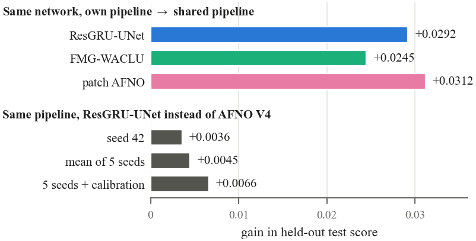
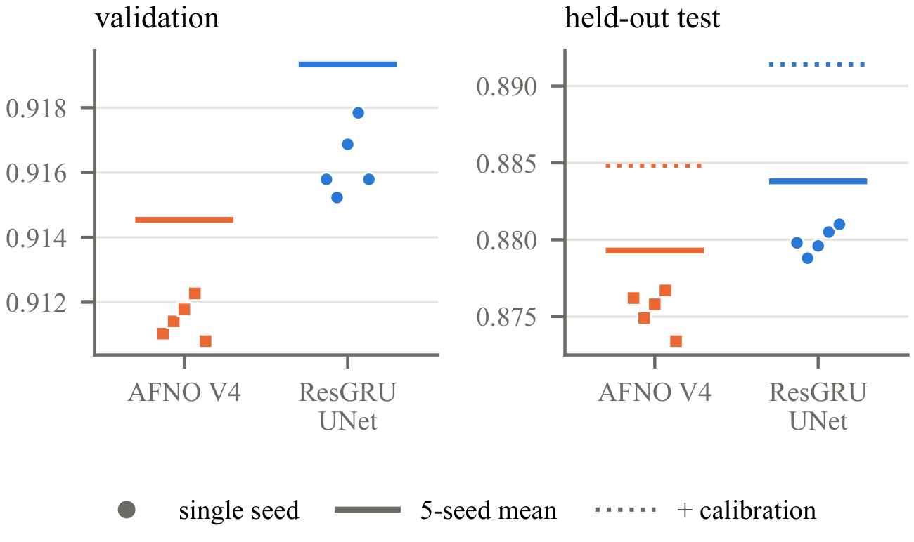
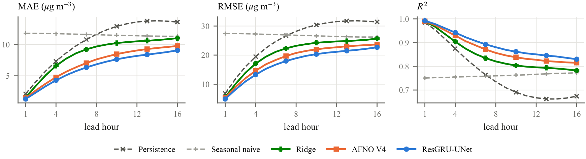
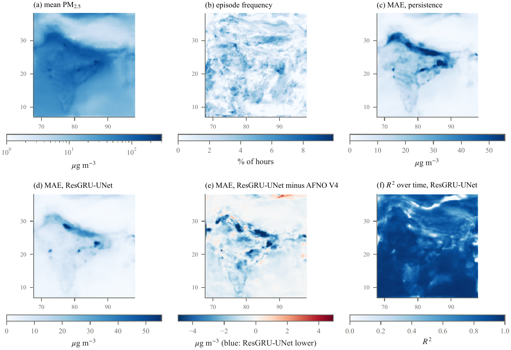
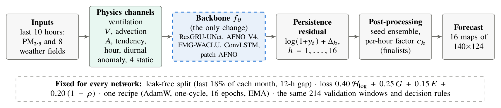

<div align="center">

# Pipeline Over Backbone

### A Controlled Study of Deep Networks for PM<sub>2.5</sub> Forecasting over India

**Vetriselvan R**, Rishihood University

[](paper/paper.pdf)
[](LICENSE)
[](pyproject.toml)
[](https://pytorch.org)

[Paper](paper/paper.pdf) - [Results](results/README.md) - [Notebooks](notebooks/) - [Data](data/README.md) - [Citation](#citation)

</div>

<br>

<p align="center">
  
</p>

<p align="center"><em>Moving a network from its own earlier pipeline into the shared pipeline raised its held-out test score by 0.025 to 0.031 (coloured).<br>Choosing ResGRU-UNet over AFNO V4 inside that pipeline added 0.0036 to 0.0066 (grey).</em></p>

## Overview

Deep networks for gridded air-quality forecasting are usually compared with their inputs, validation, loss and post-processing changed along with the architecture, so a gain cannot be credited to the network. This study separates the two.

It forecasts PM2.5 over all of India 16 hours ahead, on a 140 x 124 grid of WRF-Chem fields, and trains five networks inside one fixed, physics-informed, leak-free pipeline. Only the network changes. Decision rules were written down before each stage, and the two finalists were run with 1, 2 and 5 seeds.

The [paper](paper/paper.pdf) gives the full method, the statistics, the ablations, an ML + DL hybrid, the threats to validity and every test score.

## Key findings

**1. The pipeline matters more than the network.**
Moving the same network into the shared pipeline raised its held-out test score by 0.025 to 0.031. That is 6 to 8 times the gain from choosing between the two best networks, and 4.4 times the gap with the full recipe.

**2. Inside one pipeline, the convolutional-recurrent U-Net wins.**
ResGRU-UNet beats the adaptive Fourier neural operator AFNO V4 on all 25 seed pairs (exact rank test, p ≈ 0.004), on both parts of the test set, at every lead hour, in every month and on every regression metric. It is also cheaper: 25.8 against 48.6 ms per forecast and 0.23 against 1.36 GB of GPU memory on a T4.

**3. Rankings and post-processing depend on the metric.**
In round one, AFNO V4 is second on the benchmark score but last on MAE, RMSE and R²; ConvLSTM is last on the score but second on RMSE and R². Per-hour calibration raises the benchmark score but worsens MAE, RMSE and R²: it lowers the MAE on the 1.8% of values that are pollution episodes by 6.6% and raises it on the other values by 13.6%.

## Results

### Main results

Validation: 214 windows, 5.9 x 10<sup>7</sup> values. Test: 218 windows from 2017 with hidden targets, scored by the organizers' server (private part). MAE and RMSE in µg/m³. The benchmark score combines global SMAPE, episode SMAPE and episode correlation; higher is better.

| Model | MAE | RMSE | R² | Val score | Test score |
|:--|--:|--:|--:|--:|--:|
| Persistence | 10.44 | 26.46 | 0.767 | 0.8515 | 0.7910 |
| Seasonal naive (24 h) | 11.53 | 26.80 | 0.761 | 0.7907 | |
| Ridge regression | 8.51 | 21.48 | 0.847 | 0.8637 | 0.7951 |
| AFNO V4, five seeds | 6.99 | 19.45 | 0.874 | 0.9145 | 0.8793 |
| AFNO V4, five seeds + calibration | 7.76 | 20.90 | 0.855 | 0.9149 | 0.8848 |
| ResGRU-UNet, five seeds | **6.32** | 18.04 | 0.892 | 0.9193 | 0.8838 |
| ResGRU-UNet, five seeds + calibration | 7.12 | 19.71 | 0.871 | **0.9210** | **0.8914** |
| ResGRU-UNet, five seeds + LightGBM correction | 6.42 | **17.75** | **0.895** | 0.9051 | 0.8608 |

- **Five seeds:** the mean forecast of five networks trained with different seeds.
- **Calibration:** one factor per lead hour, fitted on validation. The validation scores of these rows use factors fitted with the scored month left out.
- **LightGBM correction:** out of fold (fitted on three months, applied to the fourth). It lowers RMSE but also the benchmark score, so it is reported and not adopted. Its test score was taken after that verdict, with the correction fitted on all four months.
- **Seasonal naive** has no test score: for lead hours 1 to 14 the hour 24 h earlier lies before the ten input hours, which is all the test windows provide.

Validation scores are higher than test scores, but validation ranks 25 network forecasts much as the test does (Spearman 0.93).

### Round one: five networks, one pipeline

Seed 42, no ensemble or calibration.

| Network | Design | Params | Val score | Test score |
|:--|:--|--:|--:|--:|
| ResGRU-UNet | conv U-Net; ConvGRU unrolled over the 16 lead hours | 7.12M | **0.9158** | **0.8798** |
| AFNO V4 | per-hour conv encoder; AFNO blocks at two scales; temporal translator | 6.98M | 0.9110 | 0.8762 |
| FMG-WACLU | ConvLSTM U-Net with wind physics | 3.45M | 0.9099 | 0.8710 |
| patch AFNO | AFNO blocks on 4 x 4 patches | 5.71M | 0.9031 | 0.8530 |
| ConvLSTM | ConvLSTM; spectral block; wind-shift advection | 19.0M | 0.8945 | 0.8452 |

### Every seed

<p align="center">
  
</p>

Every ResGRU-UNet seed beats every AFNO V4 seed, on validation and on both parts of the test set. The five-seed validation gap is +0.00479, with a 95% block-bootstrap interval of [+0.00383, +0.00578].

### Lead time

<p align="center">
  
</p>

ResGRU-UNet is best at every lead hour. Its R² falls from 0.992 at hour 1 to 0.830 at hour 16, against 0.985 to 0.674 for persistence.

### Where the error is

<p align="center">
  
</p>

*Time-averaged validation maps. (a) Mean PM2.5. (b) Share of hours that are episodes. (c, d) MAE of persistence and of the ResGRU-UNet five-seed mean. (e) MAE difference, ResGRU-UNet minus AFNO V4 (blue: ResGRU-UNet lower). (f) R² of each cell's time series, ResGRU-UNet.*

All result tables: [`results/README.md`](results/README.md).

## Method

<p align="center">
  
</p>

### Data

WRF-Chem fields released for the ANRF AISEHack 2026, Phase 2, Theme 2 challenge (IIT Delhi) on Kaggle:
- **Grid:** 140 x 124 cells, about 25 km each, over India.
- **Period:** April, July, October and December 2016, hourly.
- **Windows:** 10 input hours to 16 forecast hours.
- **Test:** 218 windows with hidden targets.

The data are simulations, not station measurements.

### Pipeline

The same for every network:
- **Inputs:** 20 channels per cell and hour: 9 fields, 4 physics channels (wind speed, ventilation, advection, tendency), the daily cycle and 4 static maps.
- **Output:** every network predicts the change of log(1 + PM2.5) from the last input hour, with a zero-initialized last layer, so an untrained network equals persistence.
- **Split:** validation is the last 18% of each month after a 12-hour gap, because windows one hour apart share 96% of their hours and a random split leaks.
- **Loss:** combines a log-space Huber term with the three terms of the benchmark score, weighted toward later lead hours.
- **Post-processing:** seed ensembles and one calibration factor per lead hour, for the two finalists.

### Benchmark score

```math
S = w_1\left(1-\frac{G}{2}\right) + w_2\,\frac{1+\rho}{2} + w_3\left(1-\frac{E}{2}\right)
```

- $G$ is the SMAPE over all cells and hours.
- $E$ is the SMAPE over episode cells.
- $\rho$ is the Pearson correlation over episode cells, computed per hour and averaged.

An hour is an episode when the cell's robust STL residual is above 3 times its standard deviation and PM2.5 is above 1 µg/m³: 1.8% of validation values. The weights are not disclosed, so validation uses $w_i = 1/3$.

### Study design

- **Rule fixed before training:** a network is better than AFNO V4 only if it leads by more than 0.003 on validation and also scores higher on test.
- **Three stages:** five networks on one seed; the two finalists with two seeds and the full recipe; then five seeds per finalist with a block bootstrap.
- **Ablations:** four single-change ablations, with predictions written before the runs.
- **Hybrid:** a LightGBM correction of the ensemble, tested by leaving one month out.
- **Verification:** before training, every one of the 15 training runs re-evaluated the original AFNO V4 checkpoint in the shared code and reproduced its validation score to five decimals. The analysis stages carry 68 automated checks, and all pass.

Each network is ported from its original notebook, and the port is checked to give exactly the original's output for the same weights.

## Repository layout

```
src/                 shared pipeline and all networks (study.py), stage sources, local loader
scripts/             builders for each Kaggle notebook, the ablation verdict, Kaggle tools
tests/               config test, port check (local_check.py), dry run of every stage
notebooks/           six local notebooks with outputs
notebooks/kaggle/    the Kaggle notebooks exactly as they ran, each with its run log
configs/             study settings (study.yaml), checked against the code by a test
results/             run records from Kaggle and the result tables
reference/           the AFNO V4 training script and the original notebooks of the ported networks
paper/               paper.tex, paper.pdf and figures
data/                download steps (data/README.md); no data included
```

## Reproduce

### Install

```bash
git clone https://github.com/Vetri-78640/pm2.5-backbone-study-pipeline-over-backbone.git
cd pm2.5-backbone-study-pipeline-over-backbone
pip install -e ".[dev]"            # or: pip install -r requirements.txt
```

### Data

Accept the competition rules on Kaggle, then follow [`data/README.md`](data/README.md). The data are not part of this repository.

### Trained weights

The five ResGRU-UNet networks of the main results, with the 16 calibration factors and the normalization statistics, are on Kaggle: [imvetri0/resgru-unet-pm25](https://www.kaggle.com/models/imvetri0/resgru-unet-pm25). With the challenge data attached, their five-seed mean with calibration reproduces exactly the forecast that scored 0.8914 on the test set (checked in `notebooks/kaggle/model_verify/`).

### Tests

```bash
pytest                                          # config against the code, seconds
pytest -m dryrun                                # every stage on synthetic data and the port check, CPU, about 35 min
python tests/local_check.py reference/originals # port check only
```

### Notebooks

Each local notebook imports the code exactly as it ran on Kaggle (through `src/local.py`) and retrains nothing.
- Notebooks 01, 02, 03 and 05 need the downloaded data; 04 and 06 read only `results/`.
- All run on a laptop CPU; `03_models` takes about 3.5 minutes.

```bash
jupyter nbconvert --to notebook --execute --inplace notebooks/01_data_and_eda.ipynb
```

| Notebook | Contents |
|:--|:--|
| `01_data_and_eda` | files, grid, PM2.5 in space and time, predictability, transport |
| `02_preprocessing` | physics channels, normalization, episode masks, leak-free split, hour estimation |
| `03_models` | the networks, a forward pass on a real window, the port check |
| `04_training` | recipe, loss, regularization, training curves |
| `05_evaluation` | score, baselines recomputed from raw data, MAE / RMSE / R², calibration |
| `06_analysis_and_ablations` | decision rules, the three stages, maps, ablations |

### Kaggle stages

Each stage in `notebooks/kaggle/` is built from `src/` by a script in `scripts/` and ran on Kaggle; the training stages used one T4 GPU.

<details>
<summary>Run a stage again</summary>

<br>

```bash
uvx --python 3.12 --from kaggle==2.2.5 --with six kaggle kernels push -p notebooks/kaggle/<stage> --accelerator NvidiaTeslaT4
```

| Stage | Builder |
|:--|:--|
| round one: `resgru`, `fmgwaclu`, `convlstm`, `patchafno` | `build_notebooks.py` |
| final round: `final` | `build_final.py` |
| seeds 1 to 3: `seeds_resgru`, `seeds_afnov4` | `build_seeds.py` |
| five-seed analysis: `analysis` | `build_analysis.py` |
| ablations: `ablations_a`, `ablations_b` | `build_ablations.py` |
| regression metrics, baselines, ridge, maps, hybrid | `build_regression.py`, `build_baselines.py`, `build_ridge.py`, `build_maps.py`, `build_hybrid.py` |
| persistence on the test set: `persistence` | none |
| check of the published weights: `model_verify` | none |

- **Builders overwrite.** The builders write into `notebooks/kaggle/` and would overwrite the notebooks that ran, so run them in a copy.
- **Rebuilt notebooks.** They differ from the committed ones in two ways. The round-one notebooks hard-coded seed 42, where `study.py` now reads a top-level `SEED` (three lines). And two comment lines in `src/` were reworded after the runs.
- **Inputs.** Each notebook expects the competition data and the AFNO V4 run output (`imvetri0/afno-v4`) attached on Kaggle.

</details>

## Citation

```bibtex
@misc{vetriselvan2026pipeline,
  author       = {{Vetriselvan R}},
  title        = {Pipeline Over Backbone: A Controlled Study of Deep Networks for {PM2.5} Forecasting over {India}},
  year         = {2026},
  howpublished = {\url{https://github.com/Vetri-78640/pm2.5-backbone-study-pipeline-over-backbone}}
}
```

## Licence

The code, results and paper in this repository are released under the [MIT licence](LICENSE).

The competition data are not included and are not covered by this licence; they are subject to the challenge's own terms on Kaggle.
